

# Chiguru · Smart Krishi

**A voice-first farm assistant that speaks the farmer's language.**

Hold a button, ask about your crop in Kannada, Hindi or English, and hear a grounded answer
in the same language, using live soil readings from your own field.

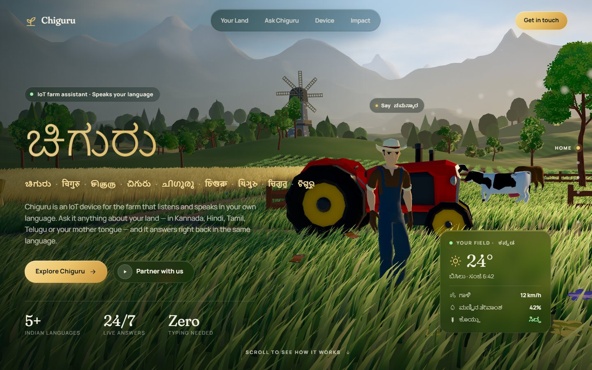

> **Chiguru** (ಚಿಗುರು) means *a new sprout* in Kannada. **Smart Krishi** (ಕೃಷಿ, *farming*) is the
> voice kiosk inside it. This repository holds the whole project: the 3D landing page, the
> ESP32 kiosk firmware, the PC bridge and the AI server.

## Contents

- [Problem statement](#problem-statement)
- [Our solution](#our-solution)
- [The hardware](#the-hardware)
- [Screenshots](#screenshots)
- [Features](#features)
- [Architecture](#architecture)
- [Why the answers can be trusted](#why-the-answers-can-be-trusted)
- [Tech stack](#tech-stack)
- [Repository layout](#repository-layout)
- [Getting started](#getting-started)
- [API reference](#api-reference)
- [Hardware wiring](#hardware-wiring)
- [Knowledge base](#knowledge-base)
- [Testing](#testing)
- [Status and roadmap](#status-and-roadmap)
- [Team](#team)
- [Credits and licences](#credits-and-licences)

## Problem statement

Farmers need answers at the moment a problem appears: the tomato leaves are yellowing, the soil
looks dry, the fertilizer bag is open. The tools they have today fall short in four ways:

1. **Language and literacy.** Most farm apps and advisories are text-heavy and written in English
   or a formal register of the state language. Many farmers would rather *speak* their question,
   in their own words, often mixing Kannada and English the way people actually talk.
2. **Generic advice.** A leaflet or a video cannot tell whether *this* field is dry *right now*.
   Advice that ignores the farmer's own soil and weather is hard to act on.
3. **Wrong answers are expensive.** A guessed fertilizer dose or a made-up pesticide name wastes
   money, damages the soil and can harm health. General-purpose AI chatbots will happily invent
   such numbers.
4. **Experts are far away.** Agriculture officers and Krishi Vigyan Kendras (KVKs) give reliable
   advice, but are rarely reachable at the moment the question comes up.

## Our solution

**Chiguru** is an IoT farm assistant that a farmer simply talks to.

| | What it does |
|---|---|
| 🎙️ **Push-to-talk kiosk** | An ESP32 with a microphone, speaker and screen. Hold the button, ask, let go. No typing, no menus, no reading needed. |
| 🗣️ **Your language in, your language out** | Speech is recognised in Kannada, Hindi or English (and code-mixed speech). The answer is translated back and spoken in the same language. |
| 📚 **Grounded answers only** | Answers come from a curated agricultural knowledge base through retrieval-augmented generation (RAG) with Gemma 4. A grounding check rejects any sentence or number that is not in the source text. |
| 🌱 **Knows your field** | A sensor node (Arduino UNO Q + DHT11 + soil-moisture probe) reports readings. Soil and watering questions are answered with the latest reading, clearly labelled real, mock or stale. |
| 🤝 **Honest when unsure** | If the knowledge base has no answer, the kiosk says so and points the farmer to the local agriculture officer or KVK. |
| 🌐 **A public face** | A scroll-driven 3D landing page explains Chiguru to farmers, FPOs and partners, with copy in five Indian languages. |

## The hardware

<table>
  <tr>
    <td width="50%">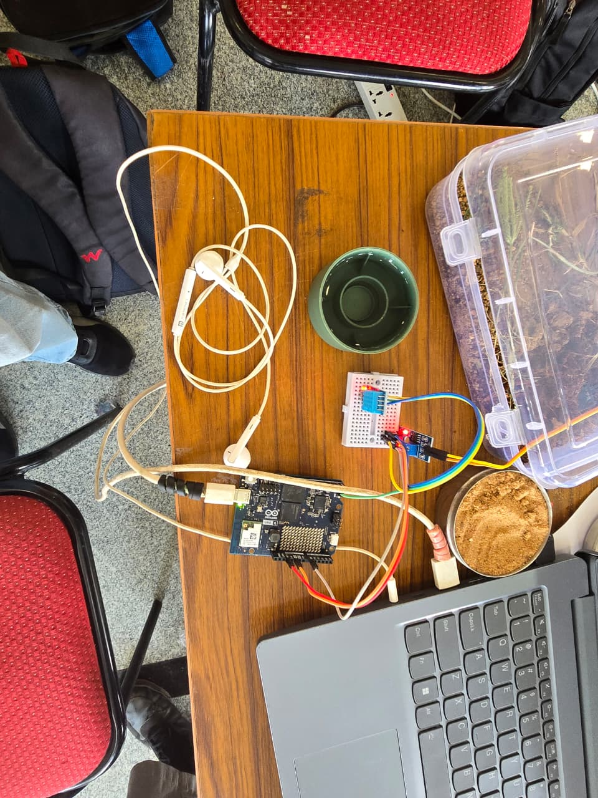</td>
    <td width="50%">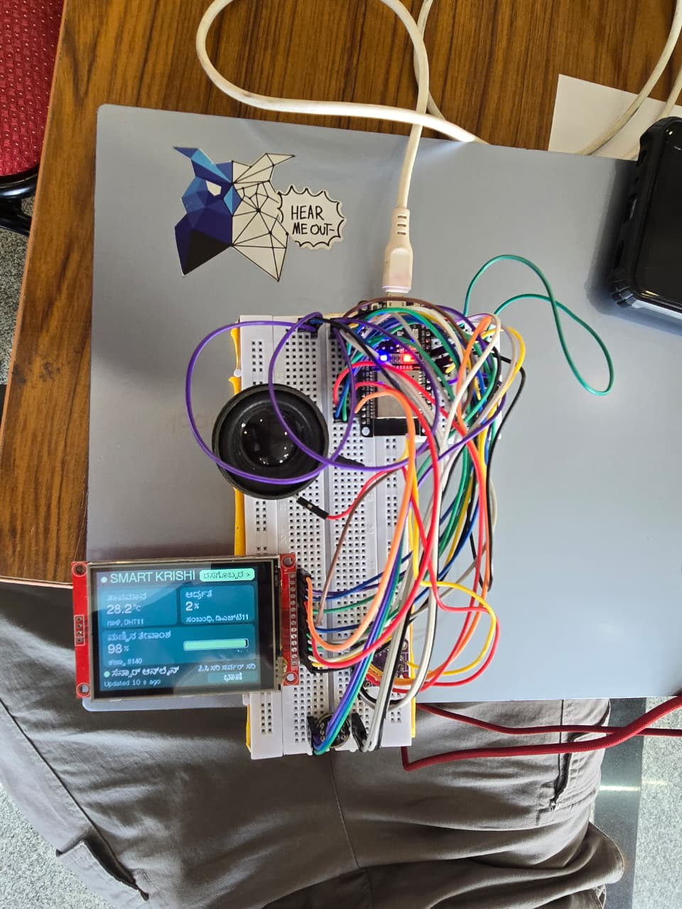</td>
  </tr>
  <tr>
    <td><b>Sensor node.</b> Arduino UNO Q with a DHT11 (air temperature and humidity) on the mini
    breadboard and a soil-moisture probe (LM393 module) in a tray of soil.</td>
    <td><b>Voice kiosk.</b> ESP32 DevKit, MAX98357A amplifier and speaker, INMP441 microphone and an
    ILI9341 TFT. Here the screen shows the field readings in Kannada: ತಾಪಮಾನ (temperature) 28.2 °C,
    ಆರ್ದ್ರತೆ (humidity) and ಮಣ್ಣಿನ ತೇವಾಂಶ (soil moisture), with "sensor online, updated 10 s ago".</td>
  </tr>
</table>

## Screenshots

The landing page is one continuous camera flight through a 3D farm. Each section of the page
moves the camera to a new part of the farm.

| | |
|---|---|
| 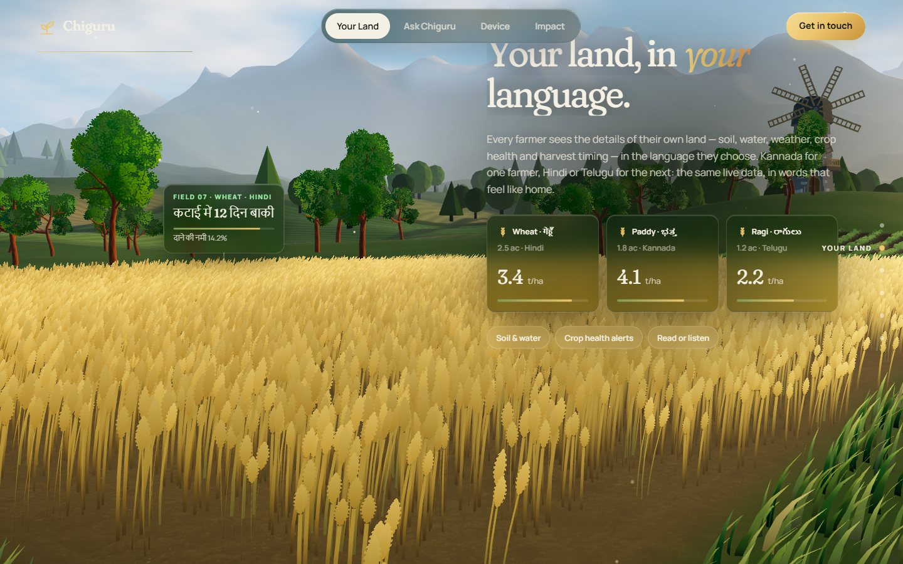 | 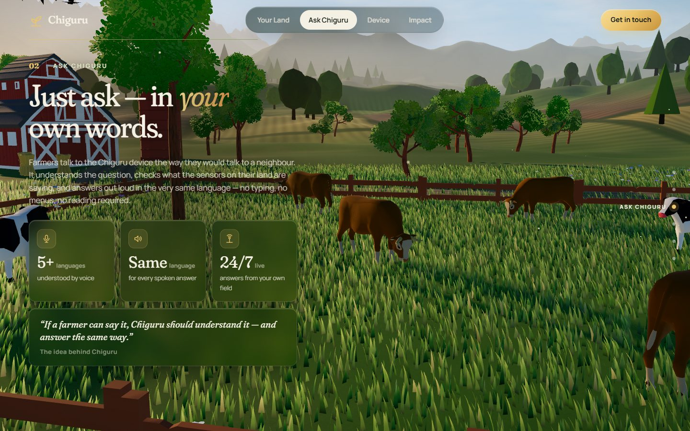 |
| **01 · Your Land.** Crop cards in Hindi, Kannada and Telugu over the wheat field. | **02 · Ask Chiguru.** Voice features beside the pasture and grazing cows. |
| 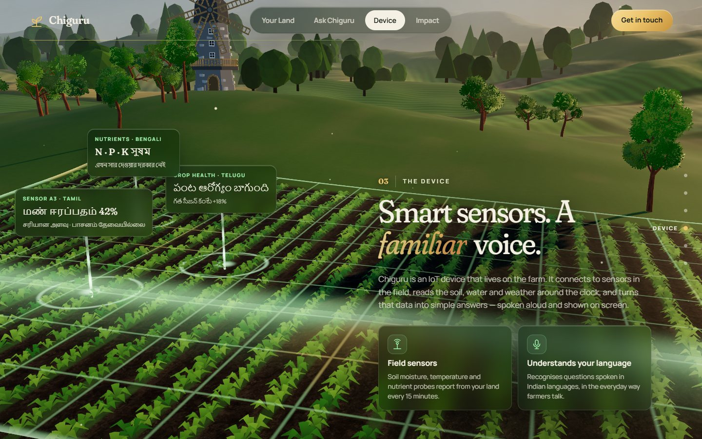 | 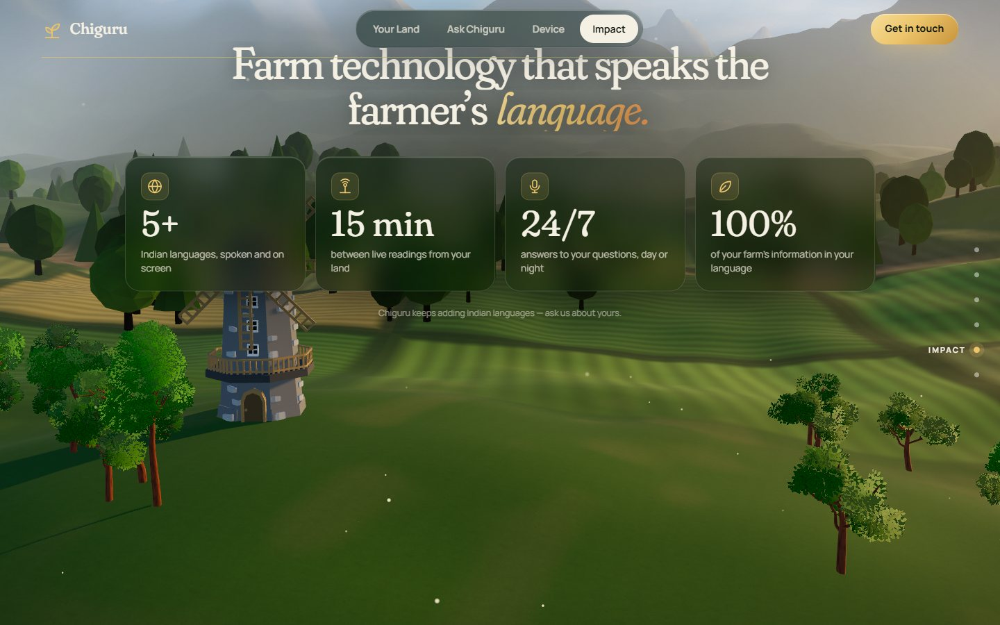 |
| **03 · The Device.** Sensor beacons and a holographic field scan over the crop rows, with labels in Tamil, Telugu and Bengali. | **04 · Impact.** Key numbers over the valley and the windmill. |
| 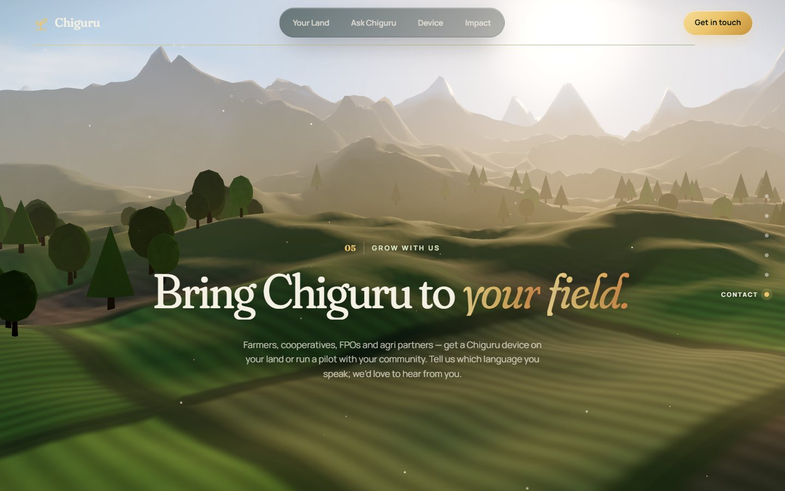 | 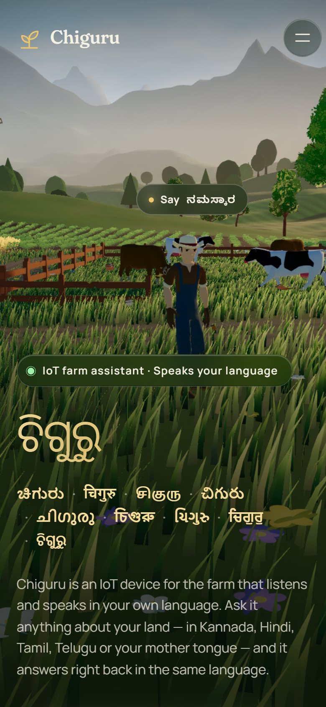 |
| **05 · Contact.** The camera rises toward the mountains and the sun. | **Mobile.** The same scene adapts to a phone, with quality tuned to the device. |

## Features

**Voice kiosk (`firmware/`, `krishi_client.py`)**
- Push-to-talk on GPIO27: presses under 0.4 s are ignored, and recording stops by itself at 15 s.
- Mic audio streams to the PC while the button is held, so nothing piles up in the ESP32's RAM.
- Spoken answers stream back as 16 kHz 16-bit PCM, sent only against credit from the ESP32, so its 32 KB buffer cannot overflow.
- Screen states: `PC offline`, `ready`, `LISTENING` with a level bar, `PROCESSING`, `SPEAKING`, plus clear error states.
- Kannada and Hindi answers are spoken in that language. The TFT shows them in Latin script, because its built-in fonts are ASCII only.
- Fallbacks: a PC earphone mic (Ctrl+Alt+4), a text-only `--ask` mode, and a hardware self-test script.

**AI server (`server/`)**
- Hybrid retrieval: Gemini embeddings plus TF-IDF over Markdown chunks, cached on disk, with relevance gates.
- Gemma 4 through Google AI Studio, with a fallback model, or Gemma 3 running locally on Ollama.
- Grounding check on every answer, plus a verbatim knowledge-base fallback if Gemma is unreachable.
- Soil-sensor endpoint with an optional device key, persisted per device.
- Short follow-up questions reuse the topic of the previous question.

**Landing page (`src/`)**
- Procedural terrain, sky and fog shaders. Instanced grass, wheat, flowers and crop rows that sway in the wind and part under the pointer.
- Animated farmer (waves on click, follows the cursor), grazing cows, a tractor with exhaust and dust, a windmill, birds, butterflies and pollen.
- GSAP + Lenis scroll choreography, with floating glass cards tied to each section.
- Automatic quality tiers (GPU, memory, touch, screen size), adaptive resolution, `prefers-reduced-motion` support, and a painted fallback when WebGL is unavailable.

## Architecture

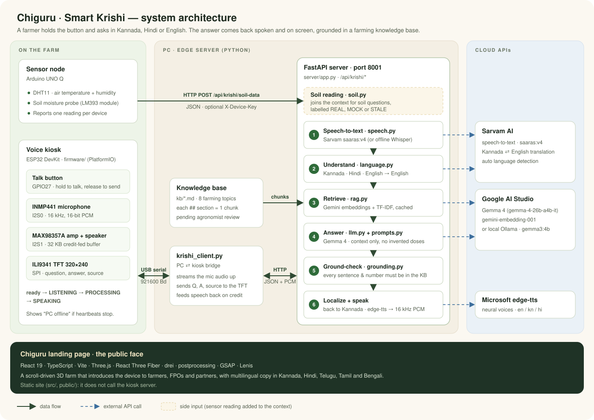

The ESP32 listens, shows and speaks. The PC does the recognition and the thinking. They talk over
the USB cable the board is flashed through, so there are no Wi-Fi credentials, IP addresses or
firewall rules on the critical path.

### One question, end to end

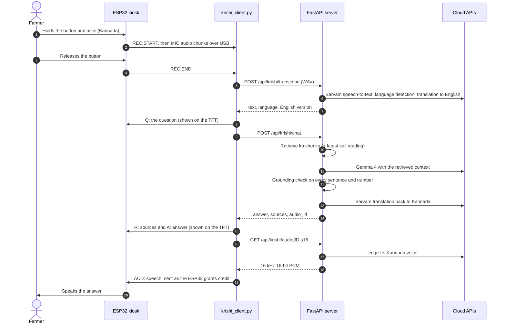

## Why the answers can be trusted

Farmers act on what they hear, so the server is built to refuse rather than guess:

- **Context only.** The prompt (`server/prompts.py`) lets Gemma answer only from the retrieved
  knowledge-base sections. Anything else returns `NOT_IN_KB`.
- **No invented doses.** Gemma may not state a fertilizer, manure, pesticide or water quantity
  unless that exact figure is in the context, and may not name a chemical product the context
  does not name. Dose questions are answered with the principle and "depends on your soil test /
  Soil Health Card".
- **Grounding check.** `server/grounding.py` verifies that every answer sentence, and every
  number, appears in the retrieved text. An answer that fails is replaced with "I don't have
  enough verified information".
- **Labelled sensor data.** A soil reading reaches Gemma as `REAL SENSOR READING`,
  `MOCK READING (simulated, not a real measurement)` or `STALE`, and Gemma must say so.
- **Prompt-injection safe.** The question and context are treated as untrusted data, never as instructions.
- **Traceable.** Every reply carries its source files and a `via` field:

| `via` | Meaning |
|---|---|
| `gemma` | Grounded answer from Gemma |
| `unknown` | Not enough verified information |
| `ungrounded` | Gemma's answer was rejected, for example for a number not in the knowledge base |
| `kb-direct` | Gemma was unreachable, so sentences were read verbatim from the knowledge base |
| `error` | Something failed. The farmer is asked to try again |

## Tech stack

| Layer | Technologies |
|---|---|
| **Landing page** | React 19, TypeScript, Vite 8, Three.js r187, React Three Fiber 9, drei 10, postprocessing, three-custom-shader-material, GSAP 3, Lenis, Fontsource (Fraunces, Manrope), oxlint |
| **Kiosk firmware** | ESP32 DevKit (`esp32dev`), Arduino framework on `espressif32` 6.9, PlatformIO, TFT_eSPI, ESP-IDF I2S driver, QRCode |
| **Kiosk hardware** | INMP441 I2S microphone, MAX98357A I2S amplifier + speaker, ILI9341 (or ST7789) SPI TFT, push button |
| **Sensor node** | Arduino UNO Q, DHT11, soil-moisture probe (LM393 module) |
| **Server** | Python 3, FastAPI, Uvicorn, Pydantic, httpx, NumPy, scikit-learn (TF-IDF), PyAV, python-dotenv |
| **Language model** | Gemma 4 (`gemma-4-26b-a4b-it`, fallback `gemma-4-31b-it`) via Google AI Studio, or `gemma3:4b` on Ollama |
| **Embeddings** | `gemini-embedding-001` + TF-IDF hybrid |
| **Speech** | Sarvam AI `saaras:v4` speech-to-text and translation, faster-whisper (offline option), Microsoft edge-tts (`en-IN-NeerjaNeural`, `kn-IN-SapnaNeural`, `hi-IN-SwaraNeural`) |
| **PC bridge** | pyserial, PyAudio, SciPy, Win32 global hotkey |
| **Tooling** | PowerShell launcher (`start.ps1`), `unittest`, ESP32 self-test script |
